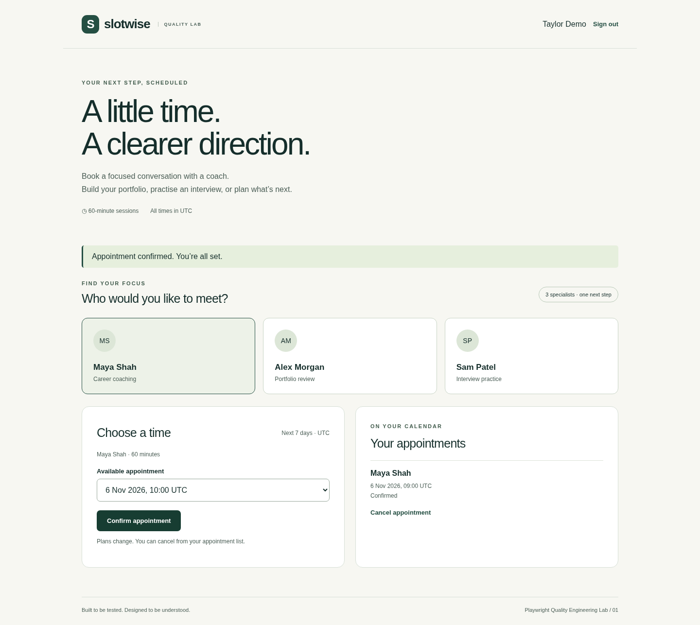

# Slotwise · Playwright Quality Engineering Lab

A working appointment-booking product paired with a risk-based automation suite. Built as an independent quality engineering portfolio project using synthetic data.

**Focus:** demonstrate how tests protect booking integrity, account ownership and the user journey—and prove that selected tests detect deliberately introduced faults.



[View the welcome screen](docs/screenshots/welcome.png) · [Quality checks](https://github.com/atharvaborade/playwright-quality-lab/actions)

## Product

Members create an account, choose a coach, book a UTC appointment, and cancel it. The application persists data in SQLite and enforces authorization in the API. Passwords use salted scrypt hashes; sessions use opaque HttpOnly cookies with hashed tokens stored server-side.

The application runs locally without a cloud subscription, API key, Docker or external database. There is no permanent hosted website.

## Run

Install **Node.js 24 LTS** (the built-in SQLite API is required), then:

```sh
git clone https://github.com/atharvaborade/playwright-quality-lab.git
cd playwright-quality-lab
npm ci
npm start
```

Open `http://localhost:3000` on your computer. Create your own account with a password of at least 12 characters. SQLite stores local data under ignored `.data/`. Stop the server with Ctrl+C; data remains for the next run.

All booking times are UTC. The UI offers seven days of availability; the API accepts supported whole-hour slots up to 90 days ahead. Coaches and accounts are fictional.

## Run the quality checks

```sh
npx playwright install chromium
npm run check
npm test
npm run test:faults
npm run report
```

On Linux, browser system dependencies may also be needed: `npx playwright install --with-deps chromium`. On a machine with a compatible system Chromium, `PLAYWRIGHT_CHROMIUM_EXECUTABLE_PATH` can select its executable. CI installs Playwright's matching browser build.

Tests launch their own app on port 3100 with a disposable database, so they do not modify your local demo accounts. Change `TEST_PORT` if necessary. Fault experiments use ports 3201 and 3202. Do not run duplicate suites on the same ports.

| Capability | Evidence |
|---|---|
| UI automation | Registration, sign-in/out, booking, reload persistence, cancellation, conflict feedback |
| API automation | Authentication, role authorization, invalid input, ownership and booking state |
| Parallel safety | Unique per-test accounts, worker-specific API slots, temporary database per server |
| Concurrency | Two accounts compete for one provider/time; exactly one booking succeeds |
| Accessibility | Axe WCAG A/AA scans on registration and booking screens; keyboard and mobile checks |
| Failure diagnosis | HTML/JSON reports, retained failure traces and screenshots |
| Test effectiveness | Two targeted test-only faults must be caught by their intended assertions |
| CI | GitHub Actions installs dependencies, checks types, runs baseline and fault experiments, uploads evidence |

## Seeded fault experiments

`npm run test:faults` temporarily enables one broken behaviour per isolated test server:

1. **Double booking:** omit the unique active provider/time constraint. The conflict test must observe 201 where 409 was required.
2. **Ownership bypass:** omit the cancellation ownership check. The isolation test must observe 204 where 404 was required.

The harness accepts only the named test's intended assertion failure. An unavailable browser, startup error, missing report or unrelated failure does not count as detection. These two examples are not a comprehensive mutation score.

Fault flags are refused outside `NODE_ENV=test`. Normal `npm start` uses the baseline behaviour. The test administrator credential in the configuration is synthetic and applies only to disposable test databases; no administrator is created in a normal local run.

## Reports and documentation

- [Delivery plan](docs/PLAN.md)
- [Test strategy and coverage decisions](docs/TEST-STRATEGY.md)
- [Architecture and engineering tradeoffs](docs/ARCHITECTURE.md)
- [Validation results and findings](docs/VALIDATION.md)
- [Interview walkthrough](docs/WALKTHROUGH.md)

In GitHub Actions, open **Actions → Quality checks → a completed run → quality-evidence** to download reports. Local HTML reports open with `npm run report`. Artifacts include synthetic authentication/session data: treat downloaded traces as test evidence and do not reuse their accounts elsewhere.

## Layout

```text
src/server.js            Express API, auth, persistence and scheduling invariants
public/                  Accessible responsive browser application
tests/fixtures/          Account factories, authenticated storage state, future slots
tests/api/               API risk checks
tests/ui/                Browser journeys and accessibility checks
scripts/check-faults.js  Verifies intended failures against seeded faults
.github/workflows/      CI and evidence retention
docs/                    Strategy, decisions, findings and walkthrough
```

## Scope and limitations

This is a portfolio lab, not a production booking platform. Current browser execution targets Chromium. Automated accessibility scans do not establish full WCAG conformance. CI configuration is included; local results do not prove that a GitHub-hosted run has completed. See the strategy for uncovered risks and deployment limitations.

No employer code, real customer data, paid services or invented performance metrics are included.
