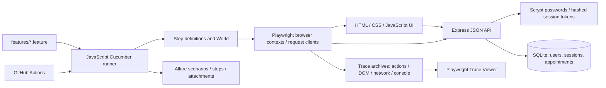

# Architecture and decisions

## Framework

Gherkin feature files live under `features/`. JavaScript step definitions describe interactions and assertions. The Cucumber World holds scenario accounts, the primary page, request clients and scenario data. Hooks create isolated browser contexts and collect evidence. This is the actual `@cucumber/cucumber` runner, not Playwright Test with BDD-style test names.

A worker reuses one Chromium browser process; each scenario receives fresh contexts and cookies. Additional accounts within a scenario have separate contexts. The runner supplies a fresh temporary database for the suite and defaults to three parallel workers. Account and slot allocation prevents accidental collisions while still allowing explicit race scenarios. Headed execution uses the same scenarios and isolation model.

Allure's Cucumber integration records scenario and step results. Playwright records traces for every scenario context, including snapshots and network activity. A reviewer can inspect the same execution from a readable Allure result or an interactive Trace Viewer. Trace replay observes saved state; it does not roll back the running application or database.

## Application

- **A real application and database:** UI and API scenarios exercise a controlled product rather than a third-party website.
- **API checks for server invariants:** Ownership, input validation and uniqueness must hold even when a caller bypasses the UI.
- **SQLite partial unique index:** Each confirmed provider/time pair is unique when requests compete. Cancelled history remains available without preventing a new booking.
- **API account creation for focused browser checks:** Most scenarios can begin with their own authenticated account. Separate browser scenarios still test the registration and sign-in forms themselves.
- **Platform JavaScript UI:** The frontend needs no build step. User-controlled values render through `textContent` rather than HTML interpolation.
- **Scrypt and opaque sessions:** Passwords use salted hashes. The database stores hashes of random session tokens. Cookies are HttpOnly and SameSite=Strict. Local HTTP is supported; hosted HTTPS requires appropriate proxy configuration and `COOKIE_SECURE=true`.
- **Test-only faults:** Narrow fault experiments verify that the suite detects a missing uniqueness constraint and missing ownership check. These are not production defaults.

The admin summary is an authenticated API capability, not a separate admin screen. Providers and working hours are fixed in the server. The UI lists the next seven UTC calendar days; the booking API accepts valid future appointments less than 90 days away. These contracts are tested as implemented rather than expanded into unbuilt product features.
