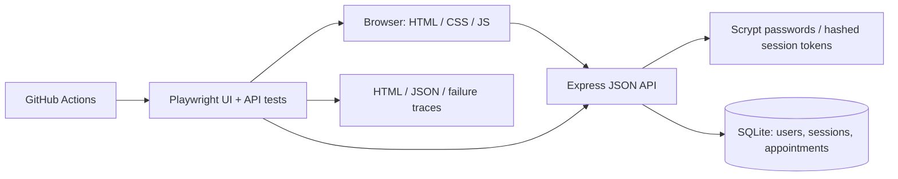

# Architecture and decisions

- **Small real application:** Tests exercise a working product and database, rather than a mocked third-party website whose behaviour we cannot control.
- **API-first risk checks:** Ownership and uniqueness are server invariants; UI-only checks would miss direct API abuse.
- **SQLite partial unique index:** A confirmed provider/time pair is unique even when requests compete. Cancelled history remains without blocking rebooking.
- **Shared authentication fixture:** Browser state comes from API registration. A separate API test covers actual login and logout revocation.
- **Platform JavaScript UI:** No frontend build dependency is needed. User-controlled values use textContent, not HTML interpolation.
- **Scrypt and opaque sessions:** Passwords are salted hashes. Only hashes of random session tokens are stored server-side. Cookies are HttpOnly and SameSite=Strict. Local HTTP is supported; set COOKIE_SECURE=true behind properly configured HTTPS before considering hosted use.
- **Test-only faults:** They make a test's detection capability observable without committing broken production defaults. This narrow experiment is not comprehensive mutation testing.
